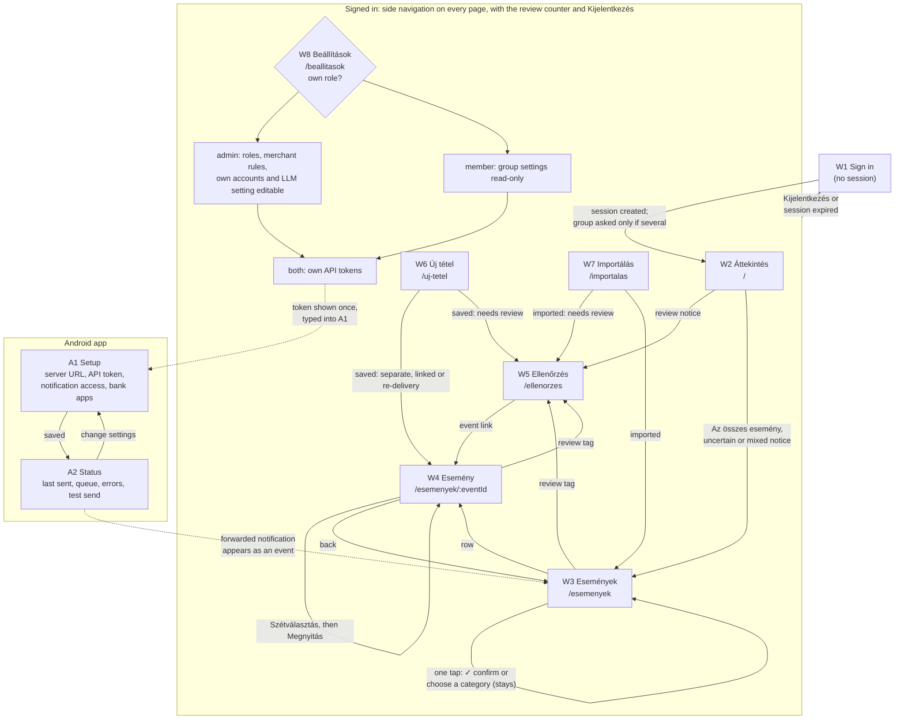
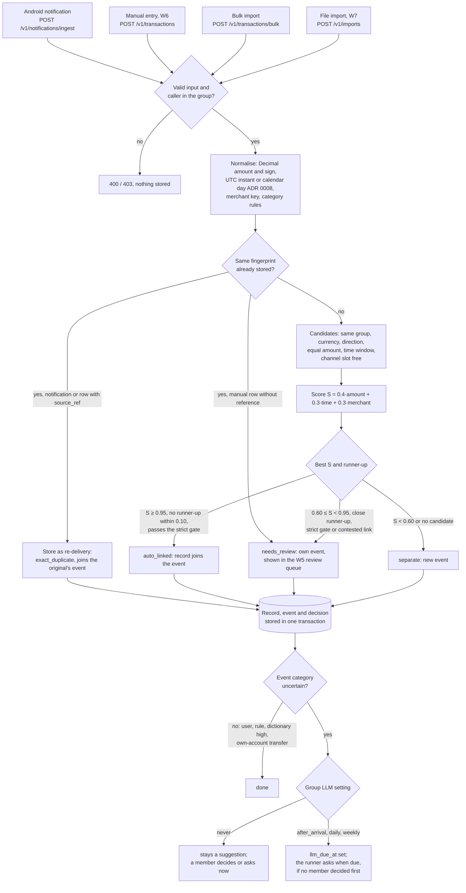
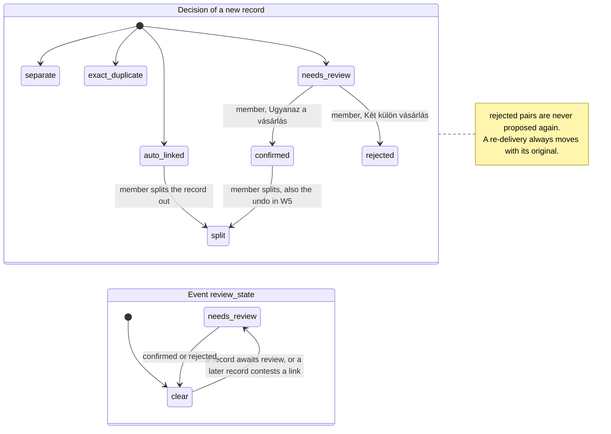
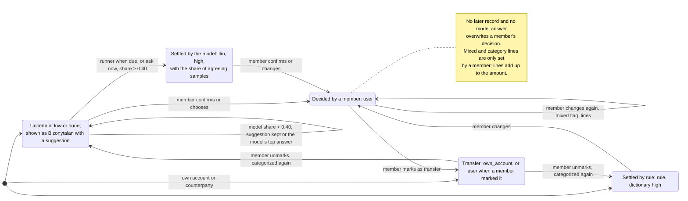
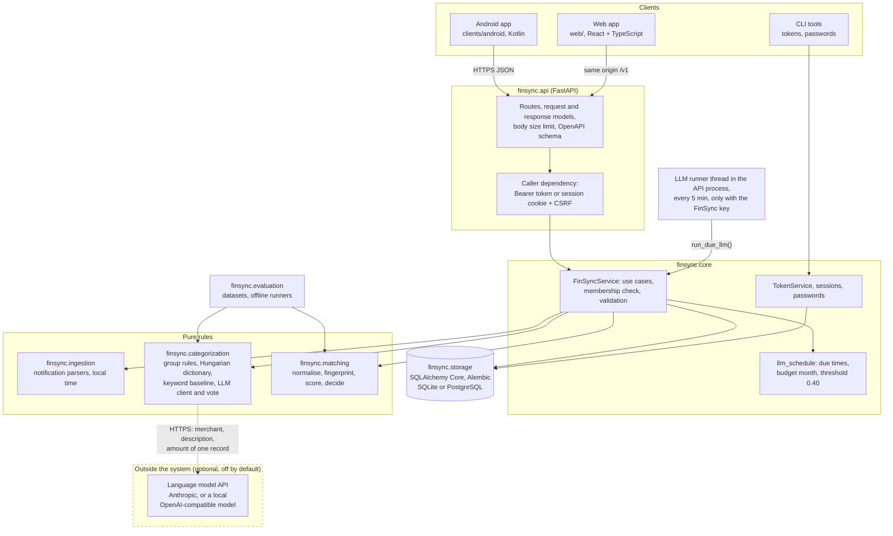
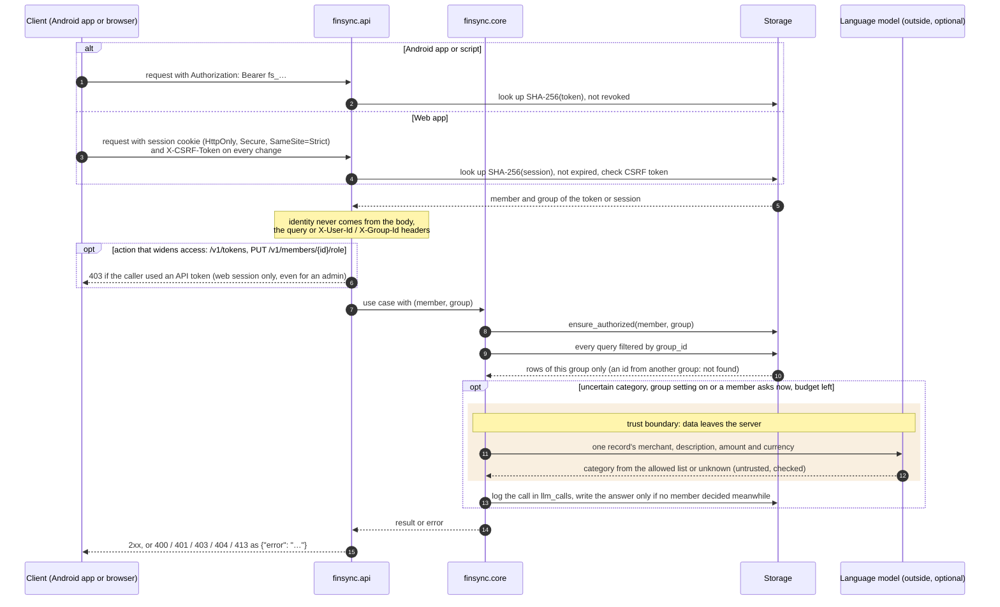

# Design views

- Status: **Checked against the code on 2026-11-24**, waiting for the author's and the supervisor's review before M2 (2026-12-04). Views 3–6 were first drawn on 2026-11-14, views 1–2 on 2026-11-19 from the built W1–W8 screens. On 2026-11-24 all six were brought in step with the category correction (source and uncertainty, confirm or change, mixed flag, category lines, transfer marking, change log) and the LLM layer in the live flow ([ADR 0013](decisions/0013-llm-in-the-live-flow.md)). The supervisor judged views 3–6 accurate and consistent with the code ([feedback, 2026-11-16](../planning/supervisor-feedback.md#2026-11-16--reply-to-the-weekly-report-of-nov-915)).
- Supervisor, [2026-11-23](../planning/supervisor-feedback.md#2026-11-23--reply-to-the-weekly-report-of-nov-1622): once the LLM layer is in the live flow, views 5 and 6 show the optional outbound model call as a trust boundary with its data-minimization rule. Done on 2026-11-24 (views 1, 3, 4, 5 and 6 show it).
- Asked for by the supervisor: six design views that form one coherent frame ([feedback, action D2](../planning/supervisor-feedback.md#2026-11-11--reply-to-the-m1-e-mail)).
- Notation: [Mermaid](https://mermaid.js.org/), which GitHub renders, so each view is versioned and reviewed like code. Names (states, routes, packages, screen ids) are the ones used in the code, so the views can be checked against it.

| # | View | State |
| --- | --- | --- |
| 1 | [Use cases](#1-use-cases) | Checked 2026-11-24 |
| 2 | [Page flow: W1–W8 and Android A1–A2](#2-page-flow-w1w8-and-android-a1a2) | Checked 2026-11-24 |
| 3 | [Ingest, match, store or review](#3-ingest-match-store-or-review) | Checked 2026-11-24 |
| 4 | [Event and decision states](#4-event-and-decision-states) | Checked 2026-11-24 |
| 5 | [Layered architecture](#5-layered-architecture) | Checked 2026-11-24 |
| 6 | [Security: authentication and group isolation](#6-security-authentication-and-group-isolation) | Checked 2026-11-24 |

## 1. Use cases

Mermaid has no use-case diagram, so this is a flowchart in UML use-case style: actors outside the system boundary, use cases as rounded boxes labelled with the screen or command that serves them. An **admin** can do everything a **member** can, plus change the group settings (author's decision, 2026-11-19); the group always keeps at least one admin. Dashed boxes are planned but not built yet. The language model is an outside system that FinSync may call; it is off until an admin turns it on ([ADR 0013](decisions/0013-llm-in-the-live-flow.md)).

```mermaid
flowchart LR
    MEM(["👤 Member"])
    ADM(["👤 Admin"])
    PHONE(["📱 Android app<br/>with the member's API token"])
    OPS(["⌨️ Operator<br/>command line"])
    LLM(["🤖 Language model<br/>optional, off by default"])
    ADM -. "is a" .-> MEM

    subgraph SYS["FinSync"]
        direction TB
        UC1(["Sign in and out — W1"])
        UC2(["See the month's totals<br/>per category and member — W2"])
        UC3(["Browse deduplicated events — W3"])
        UC4(["Inspect an event, its records<br/>and decision history — W4"])
        UC5(["Split a record out of an event — W4"])
        UC6(["Decide a proposed match:<br/>same or different purchase — W5"])
        UC7(["Add a transaction by hand — W6"])
        UC8(["Import a bank export<br/>with preview — W7"])
        UC9(["Manage own API tokens — W8"])
        UC10(["See members, merchant rules<br/>and own accounts — W8"])
        UC11(["Change member roles — W8"])
        UC12(["Manage merchant → category rules — W8"])
        UC13(["Manage own accounts<br/>and counterparties — W8"])
        UC14(["Set up and watch forwarding — A1, A2"])
        UC15(["Forward a bank notification<br/>POST /v1/notifications/ingest"])
        UC16(["Add members, set passwords,<br/>issue tokens"])
        INC(["Classify, match and store<br/>views 3 and 4"])
        UC17(["Confirm or correct a category, mixed flag,<br/>category lines, mark as transfer — W3, W4"])
        UC19(["Ask for a category<br/>suggestion now — W4"])
        UC20(["Set when the model is asked<br/>and the monthly budget — W8"])
        SUG(["Suggest a category for<br/>an uncertain event"])
        UC18(["Send Google Sheets rows<br/>POST /v1/transactions/bulk"])
    end

    MEM --- UC1 & UC2 & UC3 & UC4 & UC5 & UC6 & UC7 & UC8 & UC9 & UC10 & UC14 & UC17 & UC19
    ADM --- UC11 & UC12 & UC13 & UC20
    PHONE --- UC15
    OPS --- UC16
    MEM --- UC18
    UC7 & UC8 & UC15 & UC18 -. "«include»" .-> INC
    UC12 & UC13 -. "applied by" .-> INC
    UC17 -. "may create a<br/>merchant rule" .-> UC12
    UC19 -. "«include»" .-> SUG
    UC20 -. "schedules" .-> SUG
    SUG --- LLM

    classDef actor fill:none,stroke:none
    classDef planned stroke-dasharray: 5 5
    class MEM,ADM,PHONE,OPS,LLM actor
    class UC18 planned
```

| Actor | Who or what | Signs in with |
| --- | --- | --- |
| Member | A person in the group (role `member`) | Web session (W1), [ADR 0010](decisions/0010-web-sign-in.md) |
| Admin | A member with role `admin`; changes roles, merchant rules, own accounts and the LLM setting | Web session |
| Android app | Reads supported bank notifications on the member's phone and forwards them | The member's API token, [ADR 0009](decisions/0009-api-tokens.md) |
| Language model | Anthropic's API (ADR 0011), asked about one uncertain event at a time; gets only the record's merchant, description and amount | `FINSYNC_ANTHROPIC_API_KEY` on the server; without it nothing is sent |
| Operator | Whoever runs the server; adds members (`python -m finsync.api.members`), sets passwords (`finsync.api.passwords`), issues tokens (`finsync.api.tokens`) | Shell access to the server |

Every use case works only inside the caller's own group (view 6). Inviting and removing members stays on the command line this semester (author's decision, 2026-11-19); an API token cannot create tokens, so only the web session (UC9) or the operator (UC16) can. A member's correction (UC17) creates a merchant rule only for a merchant that is not mixed-assortment, and changes an existing rule only when the member is an admin.

## 2. Page flow: W1–W8 and Android A1–A2

Routes are those of [`web/src/App.tsx`](../../web/src/App.tsx); the side navigation (`AppShell`) reaches W2, W3, W5, W6, W7 and W8 from every page, so only the links inside pages are drawn as arrows besides it.



Notes:

- Any other path shows the "Nincs ilyen oldal" page inside the shell; without a session every path shows W1.
- On W8 the screen is the same for both roles; a member sees the group settings without edit controls, and the API refuses their changes with 403 as well, so the UI is not the only guard.
- A1 and A2 are the target screens of the Android app. Today the [spike](../../clients/android/README.md) has both on one screen (notification access, test notification, server URL and token, Send now, last result), so the arrows between A1 and A2 are the target, not the current state. The supervisor called the split the right direction for a later cleanup, but it has lower priority than the hybrid measurement, the category correction and the unified demo for M2 (2026-11-23).
- The category correction (built 2026-11-24) added actions to W3 (marker, "Csak bizonytalan kategóriák" filter, one-tap confirm or change) and W4 (category panel and history) and a notice to W2, not new pages; the LLM setting is a card on W8.

## 3. Ingest, match, store or review

Every input path runs through the same steps, synchronously on each insert ([matching design](../design/transaction-matching.md#matching-approach)). Thresholds are those of `rules-3`.



The category is decided when the record is normalised: own account or counterparty → `transfer` (`own_account`, `high`); else the group's merchant rule, then the built-in dictionary ([categorization design](../design/categorization.md#order-of-precedence)). The model is never called on the insert path; the runner and "ask now" are view 4's category states.

## 4. Event and decision states

Decisions are append-only: a later decision supersedes an earlier one for the same record, nothing is overwritten. The event itself only carries `review_state`.



The event's category has its own states ([categorization design](../design/categorization.md#review-in-the-web-app), [ADR 0013](decisions/0013-llm-in-the-live-flow.md)). Every change is appended to `category_changes`; nothing is overwritten in the log.



## 5. Layered architecture



A layer calls only the layers below it; the matching, parsing and categorization packages have no database or HTTP access ([overview](overview.md#layers-and-responsibilities)).

**The optional model call** ([ADR 0011](decisions/0011-llm-categorization-layer.md), [ADR 0013](decisions/0013-llm-in-the-live-flow.md)): the only outbound call. It goes out from the categorization layer's client, driven by the core (the runner or a member's "ask now"), never on the insert path, and only for a group whose admin turned it on, within the group's monthly budget. A local OpenAI-compatible model can stand behind the same interface and keeps the data on the server. A person's category always overrides the model's.

## 6. Security: authentication and group isolation



Details: [ADR 0009](decisions/0009-api-tokens.md) (API tokens), [ADR 0010](decisions/0010-web-sign-in.md) (web sign-in), [security and privacy](security-and-privacy.md); every endpoint has a cross-group test in `tests/test_auth.py`. Least privilege ([ADR 0012](decisions/0012-no-multi-factor-authentication.md) point 6, 2026-11-23): actions that widen access work only from a web session, so a leaked phone token stays limited to one member's data in one group; `tests/test_tokens_api.py`.

**The outbound model call** (steps in the orange box): a separate trust boundary with a data-minimization rule. Only one record's merchant, description and amount with currency leave the server, never member ids, e-mail addresses, account numbers, counterparty names or other records; the answer is untrusted input, checked against the category list ([security and privacy](security-and-privacy.md#rules)). Turning it on is an admin action from a web session only (`PUT /v1/llm-settings`, the same least-privilege rule as roles); every call is logged in `llm_calls` with who asked and what it cost ([ADR 0013](decisions/0013-llm-in-the-live-flow.md)).
