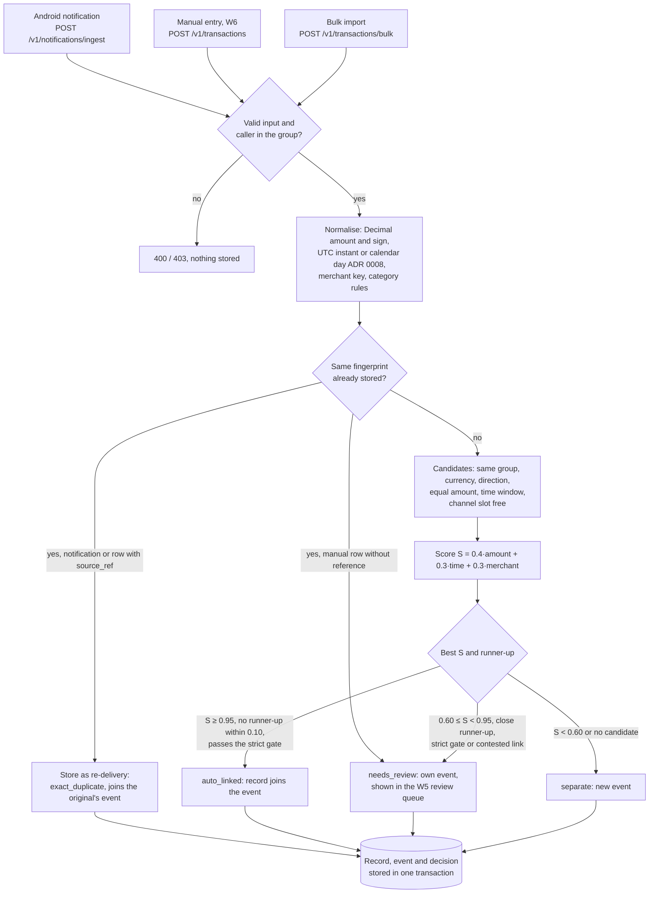
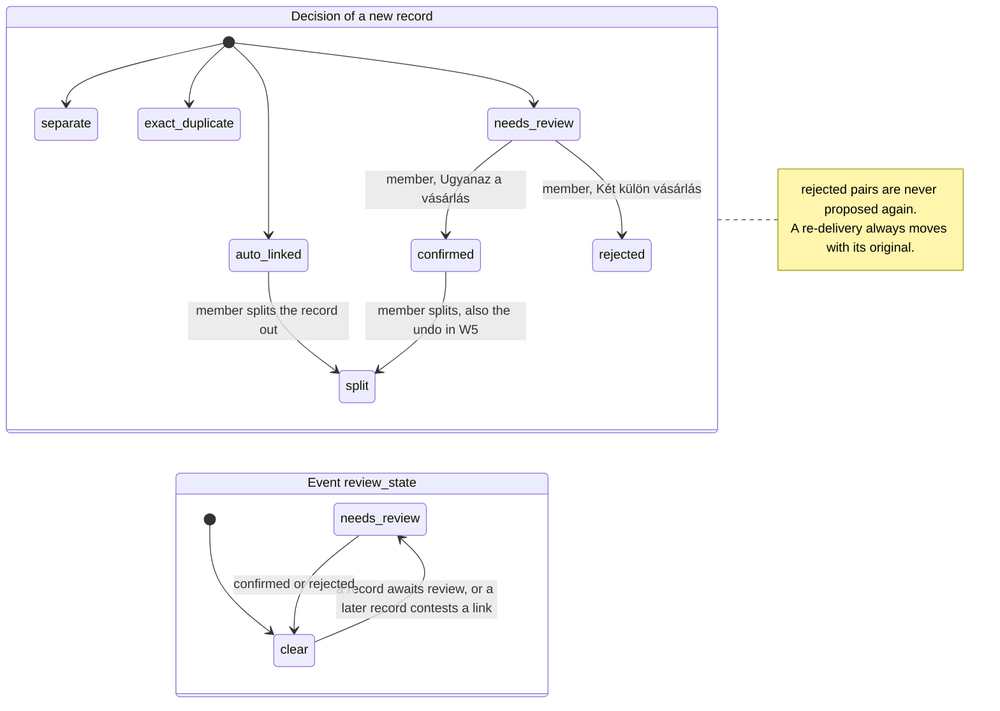
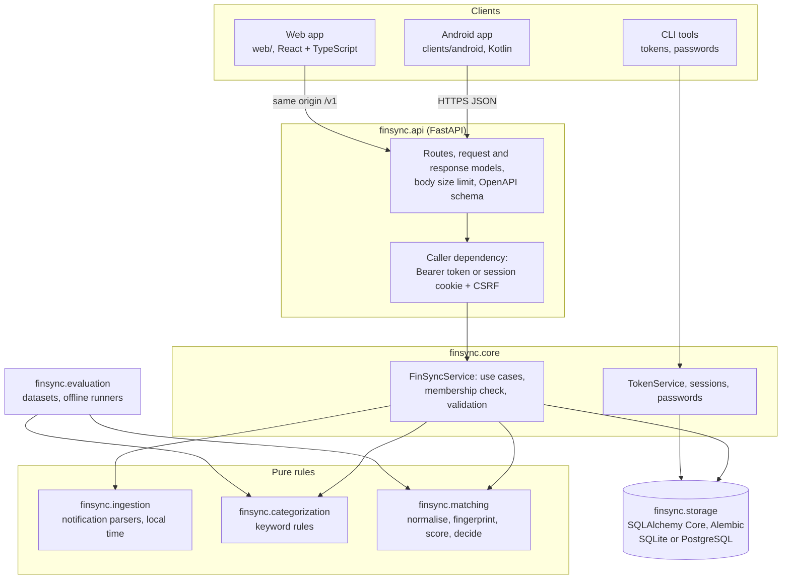
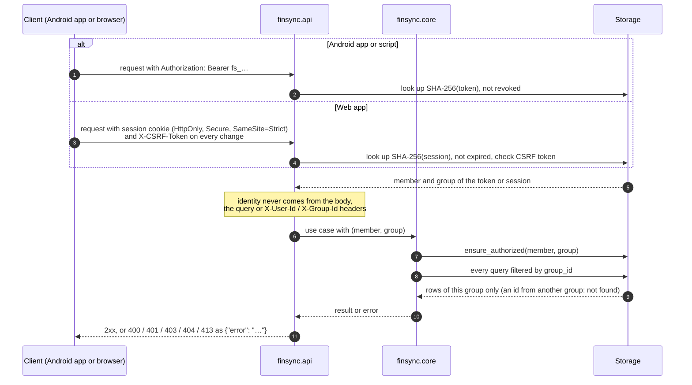

# Design views

- Status: **Draft** (2026-11-14). Views 3–6 are first drafts drawn from the code and the design documents; all six are finalised at the end of November, after the W2, W7 and W8 screens are settled, and before M2 (2026-12-04).
- Asked for by the supervisor: six design views that form one coherent frame ([feedback, action D2](../planning/supervisor-feedback.md#2026-11-11--reply-to-the-m1-e-mail)).
- Notation: [Mermaid](https://mermaid.js.org/), which GitHub renders, so each view is versioned and reviewed like code. Names (states, routes, packages, screen ids) are the ones used in the code, so the views can be checked against it.

| # | View | State |
| --- | --- | --- |
| 1 | Use-case diagram | Planned (end of November) |
| 2 | Page flow: W1–W8 and Android A1–A2 | Planned (end of November) |
| 3 | [Ingest, match, store or review](#3-ingest-match-store-or-review) | Draft |
| 4 | [Event and decision states](#4-event-and-decision-states) | Draft |
| 5 | [Layered architecture](#5-layered-architecture) | Draft |
| 6 | [Security: authentication and group isolation](#6-security-authentication-and-group-isolation) | Draft |

## 3. Ingest, match, store or review

Every input path runs through the same steps, synchronously on each insert ([matching design](../design/transaction-matching.md#matching-approach)). Thresholds are those of `rules-3`.

## 4. Event and decision states

Decisions are append-only: a later decision supersedes an earlier one for the same record, nothing is overwritten. The event itself only carries `review_state`.

## 5. Layered architecture

A layer calls only the layers below it; the matching, parsing and categorization packages have no database or HTTP access ([overview](overview.md#layers-and-responsibilities)).

## 6. Security: authentication and group isolation

Details: [ADR 0009](decisions/0009-api-tokens.md) (API tokens), [ADR 0010](decisions/0010-web-sign-in.md) (web sign-in), [security and privacy](security-and-privacy.md); every endpoint has a cross-group test in `tests/test_auth.py`.
