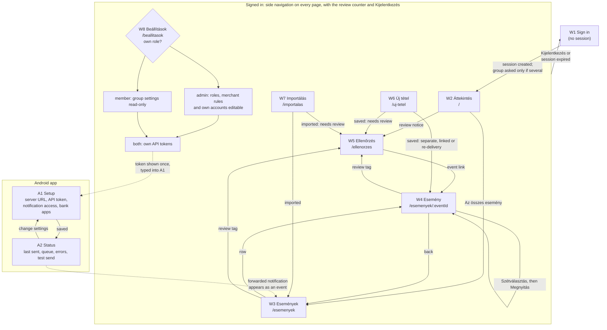
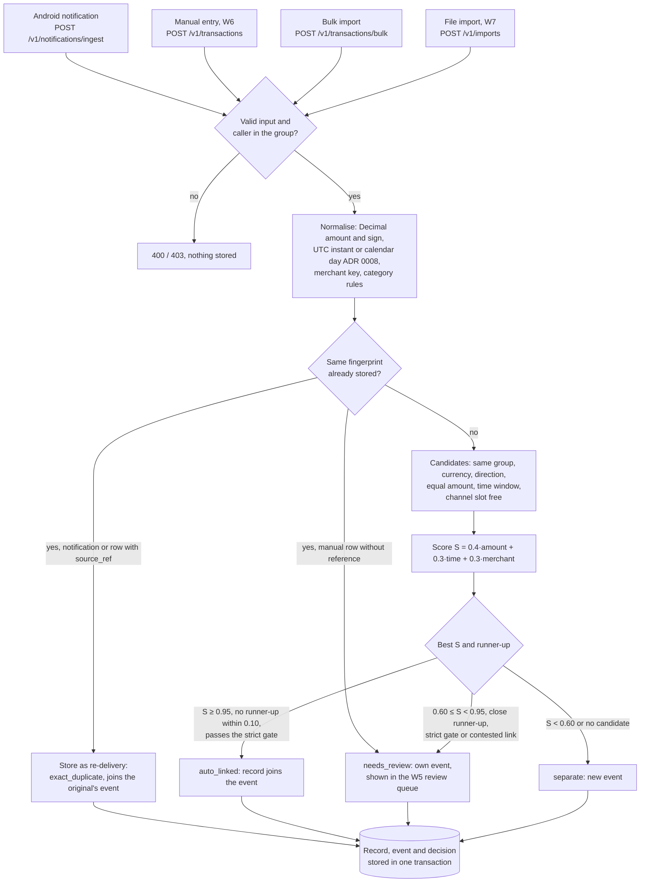
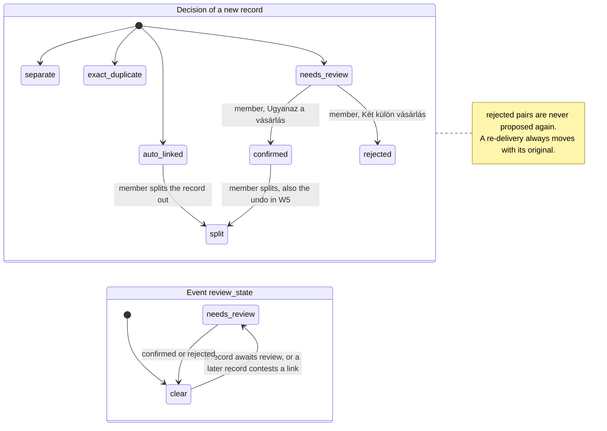
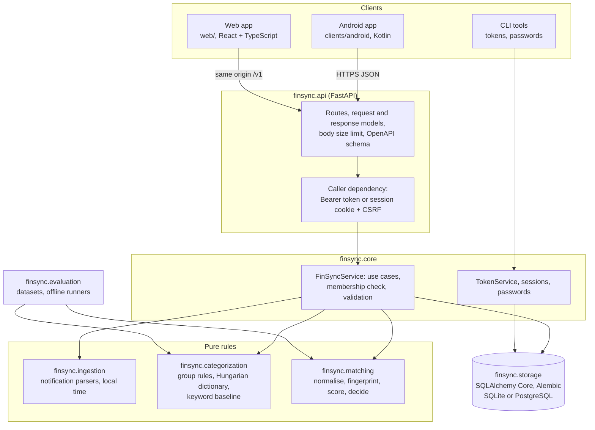
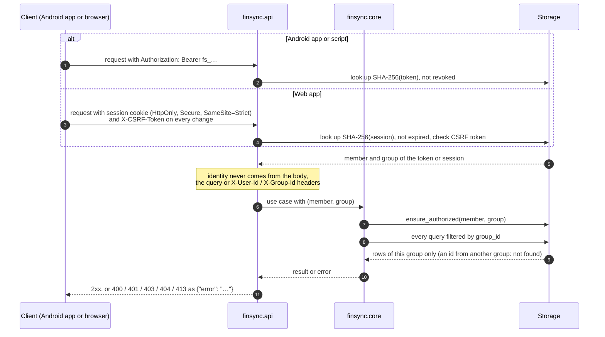

# Design views

- Status: **Draft** (2026-11-14; views 1–2 added 2026-11-19). Views 3–6 are first drafts drawn from the code and the design documents; views 1–2 were drawn on 2026-11-19 from the built W1–W8 screens (W2 and W8 with admin/member roles, [PR #31](https://github.com/h270445/FinSync/pull/31)) and the Android spike. All six are finalised before M2 (2026-12-04), after the category correction (Nov 23–27) is built. The supervisor judged views 3–6 accurate and consistent with the code and agreed to finalising views 1–2 after W2 and W8 ([feedback, 2026-11-16](../planning/supervisor-feedback.md#2026-11-16--reply-to-the-weekly-report-of-nov-915)).
- Asked for by the supervisor: six design views that form one coherent frame ([feedback, action D2](../planning/supervisor-feedback.md#2026-11-11--reply-to-the-m1-e-mail)).
- Notation: [Mermaid](https://mermaid.js.org/), which GitHub renders, so each view is versioned and reviewed like code. Names (states, routes, packages, screen ids) are the ones used in the code, so the views can be checked against it.

| # | View | State |
| --- | --- | --- |
| 1 | [Use cases](#1-use-cases) | Draft |
| 2 | [Page flow: W1–W8 and Android A1–A2](#2-page-flow-w1w8-and-android-a1a2) | Draft |
| 3 | [Ingest, match, store or review](#3-ingest-match-store-or-review) | Draft |
| 4 | [Event and decision states](#4-event-and-decision-states) | Draft |
| 5 | [Layered architecture](#5-layered-architecture) | Draft |
| 6 | [Security: authentication and group isolation](#6-security-authentication-and-group-isolation) | Draft |

## 1. Use cases

Mermaid has no use-case diagram, so this is a flowchart in UML use-case style: actors outside the system boundary, use cases as rounded boxes labelled with the screen or command that serves them. An **admin** can do everything a **member** can, plus change the group settings (author's decision, 2026-11-19); the group always keeps at least one admin. Dashed boxes are planned for M2 but not built yet.

```mermaid
flowchart LR
    MEM(["👤 Member"])
    ADM(["👤 Admin"])
    PHONE(["📱 Android app<br/>with the member's API token"])
    OPS(["⌨️ Operator<br/>command line"])
    ADM -. "is a" .-> MEM

    subgraph SYS["FinSync"]
        direction TB
        UC1(["Sign in and out — W1"])
        UC2(["See the month's totals<br/>per category and member — W2"])
        UC3(["Browse deduplicated events — W3"])
        UC4(["Inspect an event, its records<br/>and decision history — W4"])
        UC5(["Split a record out of an event — W4"])
        UC6(["Decide a proposed match:<br/>same or different purchase — W5"])
        UC7(["Add a transaction by hand — W6"])
        UC8(["Import a bank export<br/>with preview — W7"])
        UC9(["Manage own API tokens — W8"])
        UC10(["See members, merchant rules<br/>and own accounts — W8"])
        UC11(["Change member roles — W8"])
        UC12(["Manage merchant → category rules — W8"])
        UC13(["Manage own accounts<br/>and counterparties — W8"])
        UC14(["Set up and watch forwarding — A1, A2"])
        UC15(["Forward a bank notification<br/>POST /v1/notifications/ingest"])
        UC16(["Add members, set passwords,<br/>issue tokens"])
        INC(["Classify, match and store<br/>views 3 and 4"])
        UC17(["Correct a category,<br/>mixed flag, category lines"])
        UC18(["Send Google Sheets rows<br/>POST /v1/transactions/bulk"])
    end

    MEM --- UC1 & UC2 & UC3 & UC4 & UC5 & UC6 & UC7 & UC8 & UC9 & UC10 & UC14 & UC17
    ADM --- UC11 & UC12 & UC13
    PHONE --- UC15
    OPS --- UC16
    MEM --- UC18
    UC7 & UC8 & UC15 & UC18 -. "«include»" .-> INC
    UC12 & UC13 -. "applied by" .-> INC

    classDef actor fill:none,stroke:none
    classDef planned stroke-dasharray: 5 5
    class MEM,ADM,PHONE,OPS actor
    class UC17,UC18 planned
```

| Actor | Who or what | Signs in with |
| --- | --- | --- |
| Member | A person in the group (role `member`) | Web session (W1), [ADR 0010](decisions/0010-web-sign-in.md) |
| Admin | A member with role `admin`; changes roles, merchant rules and own accounts | Web session |
| Android app | Reads supported bank notifications on the member's phone and forwards them | The member's API token, [ADR 0009](decisions/0009-api-tokens.md) |
| Operator | Whoever runs the server; adds members (`python -m finsync.api.members`), sets passwords (`finsync.api.passwords`), issues tokens (`finsync.api.tokens`) | Shell access to the server |

Every use case works only inside the caller's own group (view 6). Inviting and removing members stays on the command line this semester (author's decision, 2026-11-19); an API token cannot create tokens, so only the web session (UC9) or the operator (UC16) can.

## 2. Page flow: W1–W8 and Android A1–A2

Routes are those of [`web/src/App.tsx`](../../web/src/App.tsx); the side navigation (`AppShell`) reaches W2, W3, W5, W6, W7 and W8 from every page, so only the links inside pages are drawn as arrows besides it.



Notes:

- Any other path shows the "Nincs ilyen oldal" page inside the shell; without a session every path shows W1.
- On W8 the screen is the same for both roles; a member sees the group settings without edit controls, and the API refuses their changes with 403 as well, so the UI is not the only guard.
- A1 and A2 are the planned screens of the M2 Android app. Today the [spike](../../clients/android/README.md) has both on one screen (notification access, test notification, server URL and token, Send now, last result), so the arrows between A1 and A2 are the target, not the current state.
- The planned category correction (Nov 23–27) adds actions to W3 and W4, not new pages.

## 3. Ingest, match, store or review

Every input path runs through the same steps, synchronously on each insert ([matching design](../design/transaction-matching.md#matching-approach)). Thresholds are those of `rules-3`.



## 4. Event and decision states

Decisions are append-only: a later decision supersedes an earlier one for the same record, nothing is overwritten. The event itself only carries `review_state`.



## 5. Layered architecture



A layer calls only the layers below it; the matching, parsing and categorization packages have no database or HTTP access ([overview](overview.md#layers-and-responsibilities)).

## 6. Security: authentication and group isolation



Details: [ADR 0009](decisions/0009-api-tokens.md) (API tokens), [ADR 0010](decisions/0010-web-sign-in.md) (web sign-in), [security and privacy](security-and-privacy.md); every endpoint has a cross-group test in `tests/test_auth.py`.
